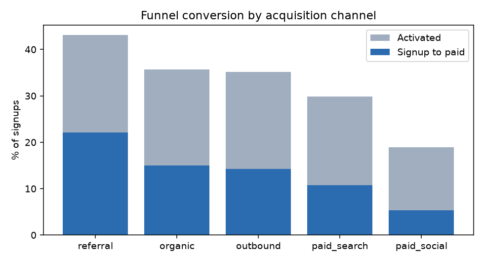
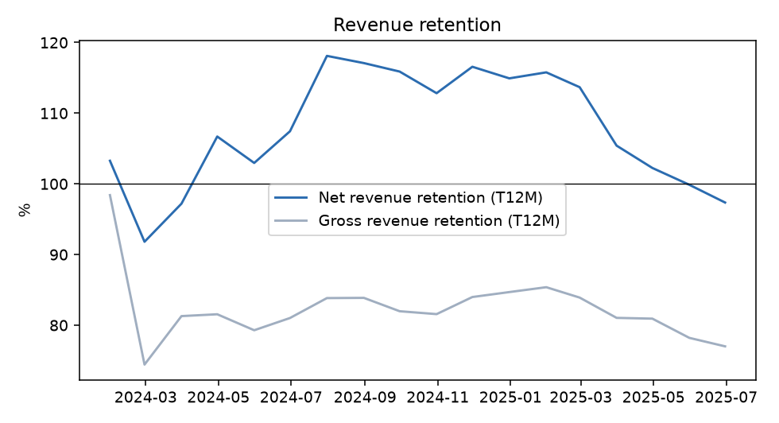
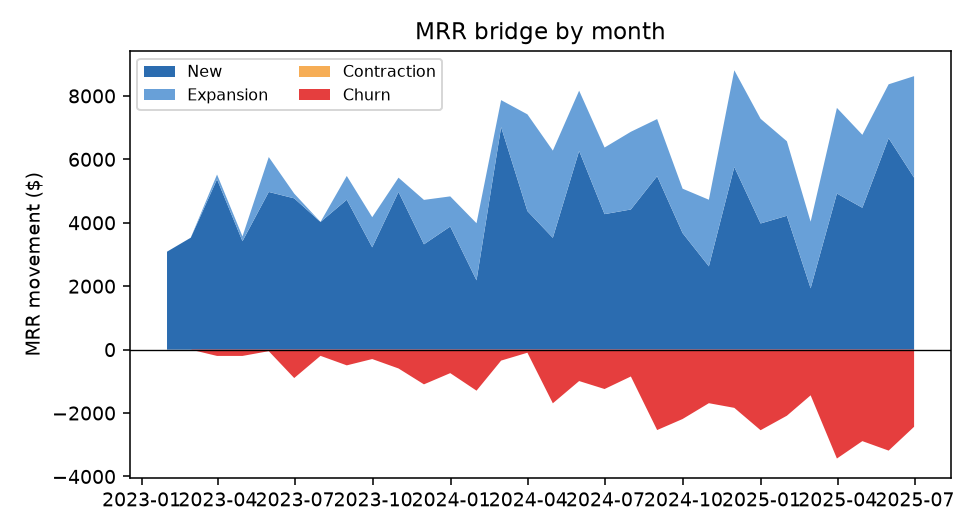

# SaaS funnel and revenue model in dbt (DuckDB)

**Synthetic data, real method.** A product-led-growth SaaS company is simulated (6,000 accounts, 2023-01 to 2025-06, fixed seed;
no employer data). The point is the analytics-engineering workflow: staged sources, tested marts with a documented grain,
and metrics a growth or finance team can trust.

## What is in the project
| layer | model | grain |
|---|---|---|
| staging | `stg_accounts`, `stg_events`, `stg_subscriptions` | one row per account / event / subscription segment |
| mart | `fct_funnel` | signup month x acquisition channel (signups, activated, paid) |
| mart | `fct_account_mrr_monthly` | account x month-end MRR |
| mart | `fct_mrr_bridge` | month: new + expansion + contraction + churn = closing - opening |
| mart | `fct_revenue_retention` | month: trailing-12-month net (NRR) and gross (GRR) revenue retention |

**Tests (15 data tests, all pass):** uniqueness and not-null on keys, `accepted_values` on channel, a `relationships`
test from subscriptions to accounts, and three singular tests: the MRR bridge must reconcile every month, funnel counts must nest
(activated and paid never exceed signups), and GRR can never exceed 1 or NRR.

**Definitions (written down on purpose).** Activated = created a project AND invited a teammate within 7 days of signup.
MRR is measured on the last day of each month. GRR caps each account at its starting MRR, so expansion cannot hide churn.

## Results
Channels, ranked by signup-to-paid conversion:

| channel | signups | activated | paid | activated % | signup to paid % |
|---|---|---|---|---|---|
| referral | 877 | 378 | 194 | 43.1 | 22.1 |
| organic | 1,831 | 653 | 274 | 35.7 | 15.0 |
| outbound | 872 | 307 | 125 | 35.2 | 14.3 |
| paid_search | 1,490 | 445 | 159 | 29.9 | 10.7 |
| paid_social | 930 | 176 | 49 | 18.9 | 5.3 |

- **referral** converts best (22.1% of signups to paid); **paid_social** converts worst (5.3%).
  Optimizing for signup volume alone would over-fund the weakest channel.
- Closing MRR at 2025-06: **$139,926**. Trailing-12-month **NRR 97.4%**, **GRR 77.0%**.
  An NRR below 100% means churn outweighs expansion.





## Caveats I would raise on a real project
- Synthetic activation and churn rates are assumptions, so the absolute numbers are illustrative; the workflow is the deliverable.
- Activation is defined within 7 days. A longer window or a different qualifying event changes channel ranking; in practice I would test that against paid conversion.
- No seasonality or pricing changes are modeled.

## Run it
```
pip install duckdb dbt-duckdb pandas matplotlib numpy
python generate_data.py
dbt build --profiles-dir .
python analyze.py
```
